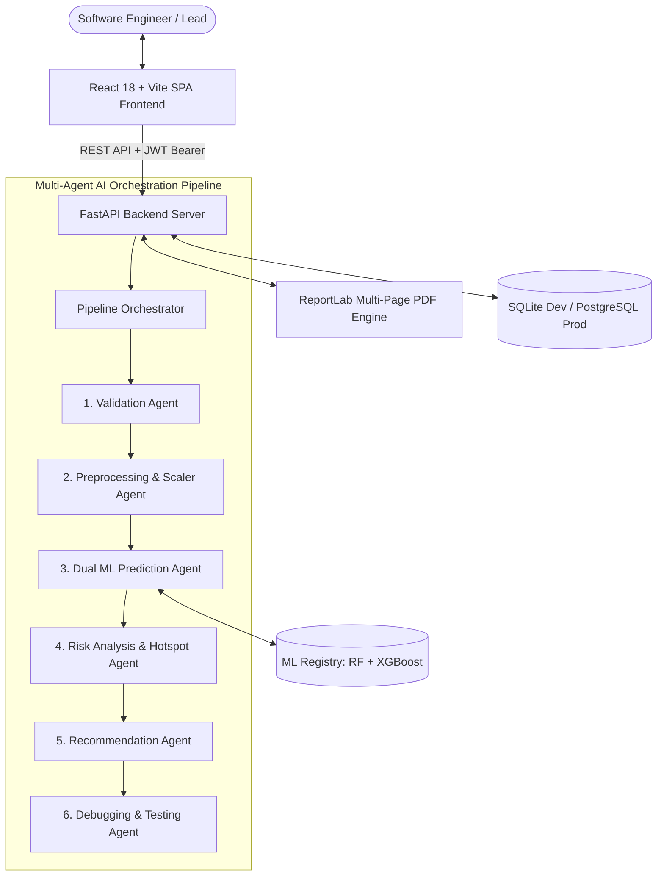

# ForeSafe AI — Autonomous Software Failure Prediction & Risk Intelligence

ForeSafe AI is an autonomous 6-agent software defect prediction and reliability intelligence platform. Powered by dual ensemble ML (Random Forest + XGBoost) trained on the NASA PROMISE JM1 benchmark and Groq LPU LLM copilot, it triages defect hotspots, explains risk via SHAP, and generates automated refactoring decisions.

---

## 1. System Architecture



---

## 2. Multi-Agent AI Pipeline

1. **Validation Agent**: Validates input CSV files against the 21 standard NASA JM1 metric dimensions (McCabe & Halstead metrics), flags format anomalies, and ensures data integrity.
2. **Preprocessing Agent**: Performs Z-score standardization (`StandardScaler`), numeric coercion, and median imputation for missing features.
3. **Prediction Agent**: Executes dual batch inference with pre-trained Random Forest and XGBoost classifiers, calculating individual probabilities and computing SHAP-inspired local feature contribution explanations.
4. **Risk Analysis Agent**: Categorizes software modules into four distinct risk tiers (**Low < 30%**, **Medium 30%–59%**, **High 60%–84%**, **Critical >= 85%**) and computes system-wide risk indices.
5. **Recommendation Agent**: Formulates human-readable, developer-oriented code refactoring suggestions based on McCabe cyclomatic complexity $v(g)$, essential complexity $ev(g)$, and Halstead comprehension effort $e$.
6. **Debugging / Rectification Agent**: Highlights path explosion bottlenecks, detects operator/operand vocabulary imbalances, and generates concrete parameterized unit testing and mutation testing plans.

---

## 3. Technology Stack

### Frontend (`frontend/`)
- **Framework:** React 18 with Vite
- **Routing:** React Router v6
- **HTTP Client:** Axios (with automatic Bearer token interceptor and 401 refresh handler)
- **Charts & Visualization:** Chart.js, `react-chartjs-2`, and custom SVG Radial Risk Gauges
- **Icons:** Lucide React
- **Design System:** Custom futuristic dark glassmorphism styling (`global.css`, `variables.css`)

### Backend (`backend/`)
- **Framework:** Python 3.11+ / FastAPI with Uvicorn
- **ORM / Database:** SQLAlchemy 2.0 (zero-config SQLite for development, PostgreSQL-ready)
- **Machine Learning:** `scikit-learn` (`RandomForestClassifier`), `xgboost` (`XGBClassifier`), `pandas`, `numpy`, `joblib`
- **Security & Auth:** Native `bcrypt` password hashing, JWT Access & Refresh Tokens (`python-jose`), Google OAuth 2.0 endpoint
- **Reporting Engine:** `ReportLab` (Multi-page PDF generation) & `openpyxl` (Excel export)
- **Testing:** Pytest & HTTPX test client

---

## 4. Quick Start & Setup

### Prerequisites
- Python 3.11+ (Python 3.13 supported)
- Node.js v18+ & npm

### Step 1: Backend Setup
```bash
cd backend

# 1. Install Python dependencies
pip install -r requirements.txt

# 2. Generate NASA JM1 dataset and train ML models
python data/generate_jm1.py
python app/ml/train.py

# 3. (Optional) Run backend tests
python -m pytest -v

# 4. Start the FastAPI backend server
python -m uvicorn app.main:app --reload --host 0.0.0.0 --port 8000
```
- API Docs will be available at: **http://localhost:8000/docs**
- Health Check: **http://localhost:8000/api/health**

---

### Step 2: Frontend Setup
```bash
cd frontend

# 1. Install dependencies
npm install

# 2. Start the Vite development server
npm run dev
```
- Frontend application will be available at: **http://localhost:5173**

---

## 5. Docker Deployment

Deploy the entire stack (FastAPI Backend + PostgreSQL + React Nginx Frontend) with a single command:

```bash
docker-compose up --build
```
- Frontend: **http://localhost:3000**
- Backend API: **http://localhost:8000/docs**

---

## 6. API Endpoints Contract

| Method | Endpoint | Description | Auth Required |
| :--- | :--- | :--- | :--- |
| `POST` | `/api/auth/register` | Register new engineer account | No |
| `POST` | `/api/auth/login` | Login with email/password | No |
| `POST` | `/api/auth/google` | Google OAuth 2.0 SSO login | No |
| `POST` | `/api/auth/forgot-password` | Request password reset token | No |
| `POST` | `/api/auth/reset-password` | Reset password using token | No |
| `POST` | `/api/auth/refresh` | Refresh JWT access token | No |
| `GET` | `/api/auth/me` | Fetch authenticated user profile | Yes (Bearer) |
| `POST` | `/api/upload` | Pre-validate CSV dataset | Yes (Bearer) |
| `POST` | `/api/predict` | Run 6-agent AI prediction pipeline | Yes (Bearer) |
| `GET` | `/api/sample-dataset` | Download sample NASA JM1 dataset | No |
| `GET` | `/api/history` | Paginated & filterable prediction history | Yes (Bearer) |
| `GET` | `/api/history/{id}` | Detailed stored analysis results | Yes (Bearer) |
| `GET` | `/api/reports/{id}/download` | Download styled multi-page PDF report | Yes (Bearer) |
| `GET` | `/api/reports/{id}/excel` | Export analysis spreadsheet (.xlsx) | Yes (Bearer) |
| `GET` | `/api/health` | Service health status & model readiness | No |

---

## 7. Assumptions & Notes

1. **NASA PROMISE JM1 Features:** Follows the standard NASA metrics repository schema: `loc`, `v(g)`, `ev(g)`, `iv(g)`, `n`, `v`, `l`, `d`, `i`, `e`, `b`, `t`, `lOCode`, `lOComment`, `lOBlank`, `locCodeAndComment`, `uniq_Op`, `uniq_Opnd`, `total_Op`, `total_Opnd`, `branchCount`, and `defects`.
2. **Email / SMTP Fallback:** When SMTP credentials are unset in `.env`, the system operates in developer mode and logs generated password reset tokens and links directly to the server terminal.
3. **Google OAuth:** A simulated 1-click test login is provided in development; in production, configure `GOOGLE_CLIENT_ID` in `.env`.
